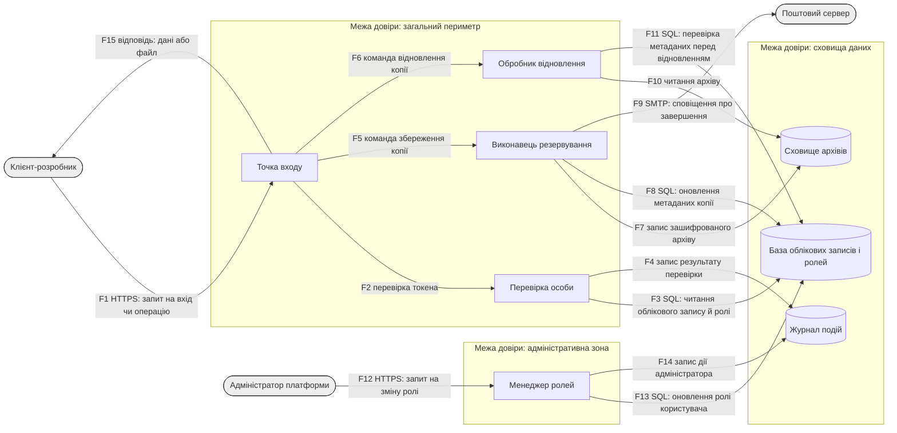

# Модель загроз: сервіс зберігання резервних копій проєктів

Варіант: 2· Здобувач: Бендік Ольга Валеріївна· Група: ІП-35

## 1. Опис системи та активи

| Актив                                                      | Тип                 | Цінність (К/Ц/Д) |
| ---------------------------------------------------------- | ------------------- | ---------------- |
| Облікові дані користувачів                                 | обліковий запис     | В/В/С            |
| Файли-архіви резервного копіювання                         | файлові дані        | В/В/С            |
| Дані про ролі користувачів і налаштування ACL              | конфігураційні дані | С/В/С            |
| Токени автентифікації(АРІ-ключі та сесійні токени)         | облікові дані сесії | В/В/С            |
| Журнал подій системи                                       | журнал              | С/В/С            |
| Ключі шифрування даних (DEK) для архівів                   | ключі               | В/В/С            |
| Працездатність сервісу резервного копіювання               | послуга             | Н/С/В            |
| Межі використання сховища для облікових записів і проєктів | конфігураційні дані | Н/С/В            |

## 2. Діаграма потоків даних



## 3. Загрози за STRIDE

| №   | Елемент/потік                               | Категорія STRIDE | Опис загрози                                                                                                                                                                | Порушувана властивість    |
| --- | ------------------------------------------- | ---------------- | --------------------------------------------------------------------------------------------------------------------------------------------------------------------------- | ------------------------- |
| 1   | admin(зовнішня сутність)                    | S                | Зловмисник входить до системи під виглядом адміна використавши викрадені облікові дані, які не були захищені MFA                                                            | автентичність             |
| 2   | identity(перевірка особи)                   | S                | Зловмисник може отримати доступ до системи без використання справжнього пароля, за допомогою слабкого механізму відновлення пароля                                          | автентичність             |
| 3   | dev(зовнішня сутність)                      | S                | Через перехоплений сесійний токен зловмисник може видати себе за розробника і виконувати дії від його імені                                                                 | автентичність             |
| 4   | role_manager(менеджер ролей)                | R                | Без доказів, зафіксованих у журналі(роль і її користувач), неможливо довести кому і яку роль адміністратор надав користувачам                                               | невідмовність             |
| 5   | dev (зовнішня сутність)                     | R                | Клієнт може заперечити виконання запиту на відновлення через брак підтвердження цього запиту                                                                                | невідмовність             |
| 6   | mailsvc (зовнішня сутність)                 | R                | Через те, що сервіс не відслідковує факт надсилання повідомлення листа, поштовий сервіс може заперечити факт надсилання листа                                               | невідмовність             |
| 7   | backup_worker (виконавець резервування)     | I                | Один ключ шифрування може призвести до того, що коли станеться його витік дані користувачів будуть доступні зловмиснику                                                     | конфіденційність          |
| 8   | account_db (база облікових записів і ролей) | I                | Незахищенні поля вводу інформації можуть дозволити зловмиснику вставити SQL-команду і отримати дані хешів паролів усієї бази даних                                          | конфіденційність          |
| 9   | entry (точка входу)                         | I                | Повідомлення про помилки надають зловмиснику доступ до інформації про устрій системи                                                                                        | конфіденційність          |
| 10  | entry (точка входу)                         | E                | Відсутність перевірки прав доступу може спричинити, що запит з чужим ID архіву може пройти без блокувань і надати доступ до даних                                           | авторизація               |
| 11  | identity (перевірка особи)                  | E                | Фейковий токен з іншою вказаною роллю може бути прийнятий системою без застосування додаткової перевірки                                                                    | авторизація               |
| 12  | event_log (журнал)                          | E                | Після атаки можна очистити журнал подій, щоб приховати сліди втручання в систему                                                                                            | невідмовність/авторизація |
| 13  | role_manager (менеджер ролей)               | E                | Користувач може самостійно змінити змінити свою роль на "власника", адже менеджер ролей не виконує загальну перевірку доступу, а пише одразу до бази                        | авторизація               |
| 14  | restore_handler (обробник відновлення)      | E                | Обробник. що займається відновленням архіву, не виконує перевірку ролі користувача стосовно окремого архіву, тому "читач" може відновити чужий проєкт                       | авторизація               |
| 15  | account_db (база облікових записів і ролей) | E                | Обліковий запис backup_worker має зайві права в базі: окрім метаданих копій, він може змінювати й ролі користувачів                                                         | авторизація               |
| 16  | entry (точка входу)                         | D                | Відсутність обмеження частоти запитів до точки входу дозволяє зловмиснику вичерпати ресурси сервера масовим надсиланням запитів, унеможливлюючи обробку легітимних звернень | доступність               |
| 17  | identity (перевірка особи)                  | D                | Зловмисник блокує чужий обліковий запис через постійні спроби входу                                                                                                         | доступність               |
| 18  | restore_handler (обробник відновлення)      | D                | Через відсутність обмеження на чергу, дозволять перевантажувати систему постійними запитами на відновлення                                                                  | доступність               |
| 19  | entry (точка входу)                         | T                | Відсутність перевірки на цілісності запиту дозволяє підмінити тип операції                                                                                                  | цілісність                |
| 20  | backup_worker (виконавець резервування)     | T                | Відсутність перевірки на цілісність даних може дозволити підмінити вміст архіву під час його збереження                                                                     | цілісність                |
| 21  | role_manager (менеджер ролей)               | T                | Роль певного користувача змінюється зловмисником під час активної сесії адміністратора без його відома                                                                      | цілісність                |
| 22  | archive_store (сховище архівів)             | T                | Відсутність перевірки власника архіву створює можливість замінити наявний файл на новий цього архіву                                                                        | цілісність                |
| 23  | F12 (admin to role_manager)                 | T                | Під час передачі даних про змінну ролі виникає можливість їх замінити в процесі передачі                                                                                    | цілісність                |

## 4. Оцінювання ризиків (CVSS / матриця)

| № загрози | Вектор CVSS                                  | Базова оцінка | Імовірність | Вплив     | Ранг ризику |
| --------- | -------------------------------------------- | ------------- | ----------- | --------- | ----------- |
| T-01      | CVSS:3.1/AV:N/AC:L/PR:N/UI:N/S:U/C:H/I:H/A:H | 9.8           | Висока      | Критичний | Критичний   |
| T-02      | CVSS:3.1/AV:N/AC:L/PR:N/UI:N/S:U/C:H/I:H/A:N | 9.1           | Висока      | Високий   | Критичний   |
| T-03      | CVSS:3.1/AV:N/AC:L/PR:N/UI:R/S:U/C:H/I:H/A:N | 8.1           | Середня     | Високий   | Високий     |
| T-04      | CVSS:3.1/AV:N/AC:L/PR:H/UI:N/S:U/C:N/I:L/A:N | 2.7           | Середня     | Низький   | Низький     |
| T-05      | CVSS:3.1/AV:N/AC:L/PR:N/UI:N/S:U/C:N/I:L/A:N | 5.3           | Висока      | Низький   | Середній    |
| T-06      | CVSS:3.1/AV:N/AC:H/PR:N/UI:N/S:U/C:N/I:L/A:N | 3.7           | Середня     | Низький   | Низький     |
| T-07      | CVSS:3.1/AV:N/AC:H/PR:N/UI:N/S:U/C:H/I:N/A:N | 5.9           | Середня     | Середній  | Середній    |
| T-08      | CVSS:3.1/AV:N/AC:L/PR:N/UI:N/S:U/C:H/I:N/A:N | 7.5           | Висока      | Середній  | Високий     |
| T-09      | CVSS:3.1/AV:N/AC:L/PR:N/UI:N/S:U/C:L/I:N/A:N | 5.3           | Висока      | Низький   | Середній    |
| T-10      | CVSS:3.1/AV:N/AC:L/PR:L/UI:N/S:U/C:H/I:H/A:N | 8.1           | Середня     | Високий   | Високий     |
| T-11      | CVSS:3.1/AV:N/AC:L/PR:N/UI:N/S:U/C:H/I:H/A:H | 9.8           | Висока      | Критичний | Критичний   |
| T-12      | CVSS:3.1/AV:N/AC:L/PR:H/UI:N/S:U/C:N/I:H/A:N | 4.9           | Середня     | Середній  | Середній    |
| T-13      | CVSS:3.1/AV:N/AC:L/PR:L/UI:N/S:U/C:H/I:H/A:H | 8.8           | Середня     | Критичний | Високий     |
| T-14      | CVSS:3.1/AV:N/AC:L/PR:L/UI:N/S:U/C:H/I:N/A:N | 6.5           | Середня     | Середній  | Середній    |
| T-15      | CVSS:3.1/AV:N/AC:H/PR:H/UI:N/S:U/C:H/I:H/A:H | 6.6           | Низька      | Критичний | Середній    |
| T-16      | CVSS:3.1/AV:N/AC:L/PR:N/UI:N/S:U/C:N/I:N/A:H | 7.5           | Висока      | Середній  | Високий     |
| T-17      | CVSS:3.1/AV:N/AC:L/PR:N/UI:N/S:U/C:N/I:N/A:L | 5.3           | Висока      | Низький   | Середній    |
| T-18      | CVSS:3.1/AV:N/AC:L/PR:N/UI:N/S:U/C:N/I:N/A:H | 7.5           | Висока      | Середній  | Високий     |
| T-19      | CVSS:3.1/AV:N/AC:L/PR:L/UI:N/S:U/C:N/I:H/A:N | 6.5           | Середня     | Середній  | Середній    |
| T-20      | CVSS:3.1/AV:N/AC:H/PR:N/UI:N/S:U/C:N/I:H/A:N | 5.9           | Середня     | Середній  | Середній    |
| T-21      | CVSS:3.1/AV:N/AC:L/PR:N/UI:R/S:U/C:N/I:H/A:N | 6.5           | Середня     | Середній  | Середній    |
| T-22      | CVSS:3.1/AV:N/AC:L/PR:L/UI:N/S:U/C:N/I:H/A:N | 6.5           | Середня     | Середній  | Середній    |
| T-23      | CVSS:3.1/AV:N/AC:L/PR:L/UI:N/S:U/C:N/I:H/A:N | 5.9           | Середня     | Середній  | Середній    |

## 5. Реєстр ризиків і рішення

## Загрози високого рівня

| №    | Ризик                                             | CVSS | Рішення  | Контрзахід                                                                                                                                                                      | Залишковий ризик                                                                                         |
| ---- | ------------------------------------------------- | ---- | -------- | ------------------------------------------------------------------------------------------------------------------------------------------------------------------------------- | -------------------------------------------------------------------------------------------------------- |
| T-01 | admin — вхід під виглядом адміна (S)              | 9.8  | зменшити | Впровадити двофакторну автентифікацію для адміна і надсилати сповіщення про вхід до системи з невідомої ІР-адреси                                                               | низький - для успішного входу в систему одного пароля вже не достатньо                                   |
| T-02 | identity — слабке відновлення пароля (S)          | 9.1  | усунути  | Токен для скидання пароля повинен мати обмеження вчасі до 15хв, бути випадковим і використовуватися лише один раз                                                               | дуже низький - підбір такого токена майже неможливий                                                     |
| T-03 | dev — викрадення сесійного токена (S)             | 8.1  | зменшити | Прив'язати токен до браузера й ІР і посилити захист cookie від несанкціонованого використання та підробки                                                                       | низький - вкрадений токен не буде працювати на іншому пристрої                                           |
| T-11 | identity — підробка claims у токені (E)           | 9.8  | усунути  | Сервер повинен самостійно визначати, який алгоритм підпису є допустимим (через жорстко заданий список), а не брати цю інформацію із заголовка самого токена, що надіслав клієнт | дуже низький - неможливо підробити токен, якщо не знаєш ключ підпису                                     |
| T-08 | account_db — SQL-ін'єкція (I)                     | 7.5  | усунути  | Коли відбувається звертання до бази даних потрібно застосовувати параметризовані SQL-запити, а не прямо вставляти дані до вмісту SQL-рядка                                      | дуже низький - тепер неможливо вставити свої дані до запиту                                              |
| T-10 | entry — IDOR за чужим ID архіву (E)               | 8.1  | усунути  | Виконувати для кожного запиту окремо перевірку чи запитувач архіву є його власником і токен є справжнім                                                                         | дуже низький - тепер відбувається перевірка права доступу до архіву під час кожного запиту               |
| T-13 | role_manager — самопризначення ролі «власник» (E) | 8.8  | усунути  | Спочатку відбувається перевірка прав адміністратора службою ідентифікації, а потім вже відбувається доступ до редагування бази даних                                            | низький - щоб обійти цей захист потрібно зламати identity, а він ще захищений методом MFA                |
| T-16 | entry — DoS без rate limiting (D)                 | 7.5  | зменшити | Обмежити кількість запитів до системи від однієї ІР-адреси і поступово сповільнювати процес надсилання відповіді при перевищенні запитів                                        | середній - якщо зловмисник буде виконувати запити з різних адрес, дане рішення буде неефективним         |
| T-18 | restore_handler — вичерпання черги (D)            | 7.5  | зменшити | Встановити ліміт на кількість запитів на відновлення і якщо запитів більше, тоді обробляти лише ті, що надійшли в межах ліміту спершу                                           | середній - якщо одночасно надішлють запит багато справжніх користувачів, тоді обмеження діятиме і на них |

## Загрози середнього рівня

| №    | Ризик                                           | CVSS | Рішення  | Контрзахід                                                                                      | Залишковий ризик                                                                                                         |
| ---- | ----------------------------------------------- | ---- | -------- | ----------------------------------------------------------------------------------------------- | ------------------------------------------------------------------------------------------------------------------------ |
| T-05 | dev — заперечення запиту відновлення (R)        | 5.3  | зменшити | Додаткове підтвердження перед важливими діями і запис до журналу                                | низький - в журналі фіксується час і дата запису, заперечити їх буде дуже важко                                          |
| T-07 | backup_worker — єдиний ключ шифрування (I)      | 5.9  | зменшити | Кожний проєкт має свій власний ключ шифрування                                                  | низький - якщо буде отримано один ключ, на інші це ніяк не вплине                                                        |
| T-09 | entry — докладні помилки (I)                    | 5.3  | усунути  | Деталі помилок показувати тільки в логах сервера, а користувачу виводити тільки загальний текст | дуже низький - зловмиснику невідомий зміст структури системи                                                             |
| T-12 | event_log — очищення журналу (E)                | 4.9  | зменшити | До журналу можна лише додавати записи, але не можна редагувати та видаляти                      | низький - журнал захищений від редагування, але права на перегляд ще потрібно реалізувати                                |
| T-14 | restore_handler — відновлення чужого архіву (E) | 6.5  | усунути  | Виконувати перевірку на власника архіву перед виконанням відновлення                            | дуже низький - перевірка прав доступу захищає чужий архів від злому                                                      |
| T-15 | account_db — надмірні права backup_worker (E)   | 6.6  | зменшити | Створити окремий акаунт із мінімально потрібними правами (тільки метадані копій)                | низький - якщо акаунт зламають зловмисники не зможуть змінити ролі                                                       |
| T-17 | identity — блокування чужого акаунта (D)        | 5.3  | зменшити | Обмежити кількість спроб для входу через CAPTCHA та блокування за IP-адресою                    | середній - якщо атака буде відбуватися з кількох ІР, це все ще може заблокувати акаунт                                   |
| T-19 | entry — підміна типу операції (T)               | 6.5  | усунути  | Під час запиту перевірється підпис на стороні сервера ключових полів                            | дуже низький - якщо відбувається зміна поля її одразу видно                                                              |
| T-20 | backup_worker — підміна вмісту архіву (T)       | 5.9  | зменшити | Перед збереження архіву потрібно виконувати перевірку хешу                                      | низький - хеш відповідає за пошук підміни, але спроба запиту не блокується                                               |
| T-21 | role_manager — CSRF на зміну ролі (T)           | 6.5  | усунути  | Впровадження унікального токену для форми змінни даних і перевірка оригінальності запиту        | дуже низький - без токену сервер блокуватиме запити                                                                      |
| T-22 | archive_store — перезапис чужого архіву (T)     | 6.5  | усунути  | Перед виконання запиту перевірити права доступу(як у загроз T-10/T-14)                          | дуже низький - якщо користувач немає прав доступу до архіву, він не зможе вносити до нього зміни                         |
| T-23 | F12 — підміна даних у транзиті (T)              | 5.9  | зменшити | Додати TLS шифрування на всі канали зв'язку всередині системи                                   | низький - без злому TLS неможливо отримати доступ до трафіку, тому залишається потреба у розмежуванні внутрішньої мережі |

## Загрози низького рівня

| №    | Ризик                                      | CVSS | Рішення  | Контрзахід                                                                   | Залишковий ризик                                                                     |
| ---- | ------------------------------------------ | ---- | -------- | ---------------------------------------------------------------------------- | ------------------------------------------------------------------------------------ |
| T-04 | role_manager — немає логу змін ролей (R)   | 2.7  | зменшити | Журнал має містити всі дані про запис: час, дату, хто і які зміни вносяться  | низький - фіксація дії передбачена, але ще потрібно реалізувати захист самого запису |
| T-06 | mailsvc — заперечення надсилання листа (R) | 3.7  | прийняти | Пояснення: Наслідки виявилися незначними, у порівнянні з отриманими вигодами | ніякі зміни не відбуваються, наступна перевірка через 6міс.                          |

## 6. Дерево атак для найкритичнішої загрози

### Обрана загроза та обґрунтування

Загрози з найвищою базовою оцінкою: T-01 (вхід до системи під виглядом адміна) і T-11 (підміна даних у токені) — обидві 9,8.
За однакових оцінок обрано загрозу, що зачіпає цінніший актив — T-11.
Обґрунтування:

1.  Категорія загрози відповідає пріоритетній категорії варіанта — Elevation of privilege.
2.  Загроза передбачає наявність лише одного слабкого місця під час перевірки токена для доступу в систему, тоді як Т-01 додатково вимагає скомпрометованих облікових даних адміністратора, тобто Т-11 має нижчий поріг входу для зловмисника.
3.  Загроза опосередковано відкриває доступ до трьох ключових активів: токени автентифікації (API-ключі та сесійні токени), дані про ролі користувачів і налаштування ACL, файли-архіви резервного копіювання.

```
Мета: Отримати в системі права, що перевищують фактично надані
 OR
 │-- Шлях 1. Використати прямий шлях role_manager до бази даних
 │    AND
 │    │-- Створити звичайний обліковий запис
 │    │    (реєстрація відкрита, перевірки особи немає)
 │    └── Надіслати запит на зміну ролі напряму до role_manager
 │         OR
 │         │-- Знайти ендпоінт шляхом аналізу клієнтського коду або API-документації
 │         └── Спробувати стандартні URL-шляхи для керування ролями (/admin, /roles, /manage)
 │
 └── Шлях 2. Сфальсифікувати повноваження за допомогою токена
      OR
      │-- Змусити сервер прийняти токен без перевірки підпису
      │    AND
      │    │-- Підтвердити вразливість механізму перевірки підпису токена
      │    └── Згенерувати власний токен із підвищеними правами
      │
      └── Отримати доступ до оригінального ключа підпису
           OR
           │-- Віднайти ключ, залишений у відкритому доступі (репозиторій, журнали CI)
           └── Відновити симетричний ключ шляхом перебору можливих значень
```

## Таблиця вартостей вузлів дерева атак

Тепер для того щоб з'ясувати, яка з гілок дерева є найдешевшою для використання зловмисниками, оцінемо вартість кожного листка в дереві за метрикою людино-годинах, а також визначено вартість вузлів: для вузла OR беремо мінімальну вартість серед нащадків, а для AND підсумовуємо вартість нащадків. Розрахунок був виконаний знизу вгору, тобто від листя до кореня дерева.

| Назва вузла/листя                                         | Тип  | Вартість (людино-год) | Як було отримано                                                           |
| --------------------------------------------------------- | ---- | --------------------- | -------------------------------------------------------------------------- |
| Створити звичайний обліковий запис                        | лист | 0,1                   | реєстрація доступна всім і займає декілька хвилин                          |
| Спробувати стандартні URL-шляхи (/admin, /roles, /manage) | лист | 1                     | автоматична перевірка URL-шляхів для адмін-панелей                         |
| Знайти ендпоінт через аналіз коду/API                     | лист | 5                     | опрацювання вихідного коду та документації                                 |
| Надіслати запит на зміну ролі напряму                     | OR   | min(5; 1) = 1         | вибираємо найдешевший спосіб пошуку ендпоінта з двох наявних               |
| Шлях 1 (разом)                                            | AND  | 0,1 + 1 = 1,1         | без одного з двох кроків (обліковий запис і ендпоінт) атака не відбудеться |
| Підтвердити вразливість перевірки підпису токена          | лист | 2                     | тестування реакції сервера на спеціально створений неправильний токен      |
| Згенерувати власний токен із підвищеними правами          | лист | 1                     | програмне забезпечення для створення токенів                               |
| Змусити сервер прийняти токен без перевірки підпису       | AND  | 2 + 1 = 3             | окремо жоден крок не дасть очікуваного результату                          |
| Віднайти ключ у відкритому доступі (репозиторій, CI)      | лист | 4                     | пошук у відкритих джерелах за типовими ознаками витоку ключів              |
| Відновити симетричний ключ перебором                      | лист | 40                    | тривалість перебору ключів залежить від довжини та стійкості ключа         |
| Отримати доступ до ключа підпису                          | OR   | min(4; 40) = 4        | обирається дешевший спосіб                                                 |
| Шлях 2 (разом)                                            | OR   | min(3; 4) = 3         | набагато простіше обійти перевірку підпису, ніж відшукати ключ             |
| Корінь дерева                                             | OR   | min(1,1; 3) = 1,1     | Шлях 1 виявився найдешевшим шляхом до поставленої мети                     |

Висновок: найдешевший шлях — Шлях 1 (1,1 людино-години), що представляє загрозу T-13 (прямий доступ role_manager до бази в обхід перевірки прав), а не компрометація токена (T-11), яка коштує щонайменше 3 людино-години, попри вищу формальну оцінку CVSS (9,8 проти 8,8).

Висновок: найдешевший шлях - Шлях 1(1,1 людино-години), що представляє загрозу T-13(прямий доступ role_manager до бази в обхід перевірки прав), а не компрометація токена (T-11), яка коштує щонайменше 3 людино-години, попри вищу формальну оцінку CVSS (9,8 проти 8,8).

## 7. Висновки

Під час аналізу і побудови моделі було виявлено 23 загрози для сервісу зберігання резервних копій, що вдвічі перевищує мінімальну вимогу. Початкова гіпотеза про пріоритетність категорії Elevation of privilege підтвердилася: саме вона дала найбільшу кількість загроз — 6, тоді як категорія Tampering дала 5, а решта категорій — по 3 кожна. Такий результат очікуваний, бо сервіс постійно працює з різними ролями користувачів і правами доступу до даних, тому саме в цій категорії найбільше можливостей для їх підвищення.

За шкалою CVSS 9 із 23 загроз отримали високий або критичний ризик. Найкритичнішою виявилася T-11 (підробка токена, оцінка 9,8): атака не вимагає ні попередніх прав доступу, ні дій з боку жертви, а її наслідком є повний контроль зловмисника над системою — читання, редагування та видалення даних. Проте під час побудови дерева атак найдешевшим шляхом до підвищення привілеїв виявилася інша загроза — T-13 (обхід перевірки прав через архітектурну помилку). Це показує, що найвищий бал CVSS ще не є показником найдешевшого реального шляху атаки.

Найбільш вразливими виявилися процеси, розташовані на межах довіри (entry, identity, role_manager) — саме там, де дані щойно потрапили до системи. Один простий контрзахід — перевіряти під час кожного звернення, чи є користувач справжнім власником ресурсу, — закрив одразу три різні загрози. Це підтверджує, що ефективніше усувати саму причину проблеми, ніж боротися з кожним її проявом окремо.

З 23 виявлених загроз лише одна отримала рішення «прийняти», решта розподілилися між «усунути» - 10 та «зменшити» - 12 . Ці результати підтверджують якість проведеного аналізу: немає категорій із винятково низькими оцінками, врахована навіть категорія Repudiation, і кожна загроза має зрозумілий контрзахід.
